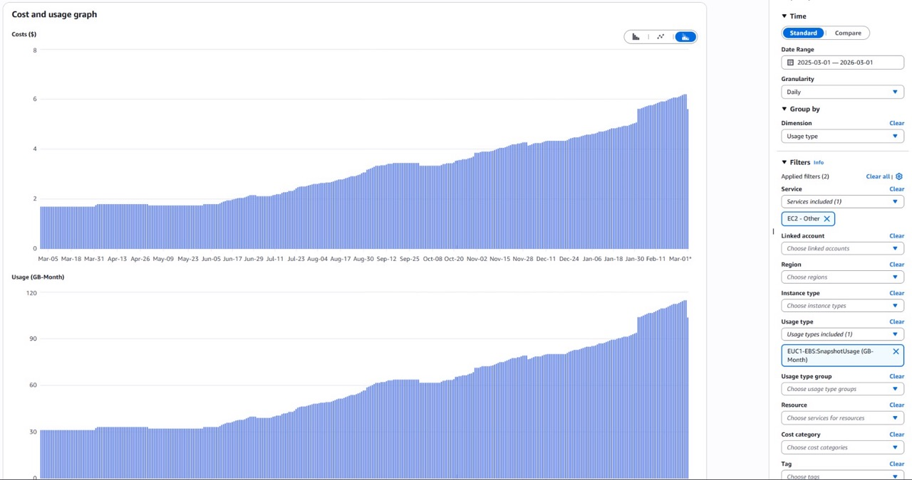
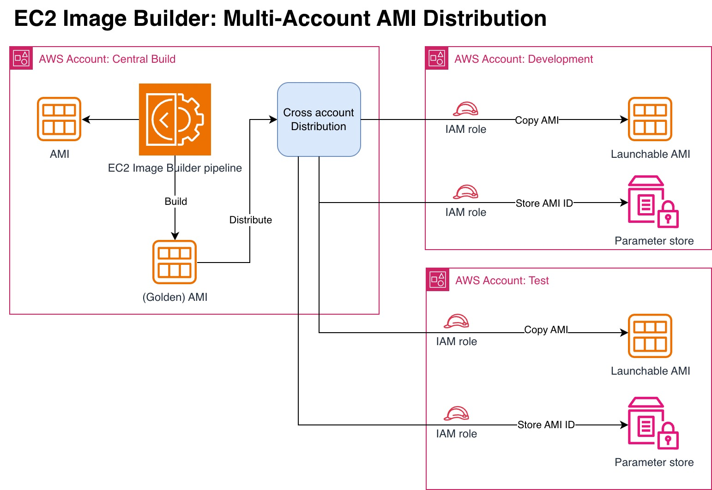

A few months ago I was performing a cloud cost analysis for a project. One of the things that stood out during the analysis was the slowly increasing `EC2-Other` category in AWS Cost Explorer.

After looking at the Usage Type, it appeared the size for EC2 snapshots storage was increasing day after day in the account. 



During the investigation it became apparent that this trend was visible across multiple accounts. Finding the root cause took a bit of investigation, so I decided to write it down in case others would run into the same problem.

## The workload

The workload was an application running on Windows EC2 instances. In a central build account, a new version of the application would be installed on a predefined Windows version and baked into a new Amazon Machine Image (AMI). To do that, an [EC2 Image Builder](https://docs.aws.amazon.com/imagebuilder/latest/userguide/what-is-image-builder.html) pipeline was created that ran on a daily schedule and resulted in a new AMI with a corresponding EBS volume. When the new AMI was created successfully by the pipeline, the AMI was distributed to other AWS accounts within the organization by means of the EC2 Image Builder pipeline feature called cross-account image distribution. 

Each day, a scheduled deployment would trigger and the deployment would replace the Windows EC2 with a new instance based on the latest published AMI, at which time the old AMI would become obsolete. 

## Cross-account AMI distribution

There are different ways to share AMIs with other accounts. In this project the setup was chosen to use cross-account AMI distribution, a built-in feature of EC2 Image Builder pipelines. Cross-account AMI distribution works in such a way that AMIs build from the AMI builder pipeline gets copied into target accounts.



To be able to distribute images to other accounts a specific role needs to be created in the target account as documented at [set up cross-account AMI distribution with Image Builder](https://docs.aws.amazon.com/imagebuilder/latest/userguide/cross-account-dist.html).

The role needs to have the fixed name  **EC2ImageBuilderDistributionCrossAccountRole** and deployed in all accounts that will receive the image. The role requires at least one explicit policy named **Ec2ImageBuilderCrossAccountDistributionAccess.**

On inspection of the policy it's clear that the policy allows for the creation of tags on images and it allows for operations relate to images.

```json
{
    "Version": "2012-10-17",
    "Statement": [
        {
            "Effect": "Allow",
            "Action": "ec2:CreateTags",
            "Resource": "arn:aws:ec2:*::image/*"
        },
        {
            "Effect": "Allow",
            "Action": [
                "ec2:DescribeImages",
                "ec2:CopyImage",
                "ec2:ModifyImageAttribute"
            ],
            "Resource": "*"
        }
    ]
} 
```

_Policy as shown on 17-10-2026._

In AWS CDK the role was implemented similar to:

```typescript
const distributionRole = new iam.Role(this, 'EC2ImageBuilderDistributionCrossAccountRole', {
  roleName: "EC2ImageBuilderDistributionCrossAccountRole",
  description: "Role assumed by EC2 Image Builder to copy AMIs",
  assumedBy: new iam.AccountPrincipal('123456789012'), // Replace with your AWS EC2 Image Builder pipeline account ID
  managedPolicies: [
    iam.ManagedPolicy.fromAwsManagedPolicyName('Ec2ImageBuilderCrossAccountDistributionAccess'),
  ]
});
```

To know in the target account what the ID would be of the latest AMI, cross-account AMI distribution  would also store the latest AMI identifier as a parameter in the parameter store of the target account. To be able to do that an additional policy is required for the **EC2ImageBuilderDistributionCrossAccountRole**.

```typescript
distributionRole.addToPolicy(new iam.PolicyStatement({
  actions: ['ssm:PutParameter'],
  resources: [this.formatArn({
    service: 'ssm',
    resource: 'parameter',
    resourceName: 'ImageBuilder-*',
  })],
}));
```

## AMI lifecycle management

To prevent an ever increasing number of images in both the build and the target accounts, an Image Builder lifecycle policy had been setup, as documented in [Lifecycle management prerequisites for Image Builder images](https://docs.aws.amazon.com/imagebuilder/latest/userguide/image-lifecycle-prerequisites.html). The lifecycle policy automates the deprecation, disabling, and deletion of outdated images and their associated resources. 

To enable cross-account lifecycle management a second IAM role is required in the target accounts. The role allows the initiation of lifecycle management from the central build account. With CDK you will need to create an IAM role that looks similar to the following code snippet:

```typescript
new iam.Role(this, 'Ec2ImageBuilderCrossAccountLifecycleAccess', {
  roleName: "Ec2ImageBuilderCrossAccountLifecycleAccess",
  assumedBy: new iam.ServicePrincipal("imagebuilder.amazonaws.com").withConditions({
    "StringEquals": {
      "aws:SourceAccount": "<replace-with-build-account-id>"
    },
    "ArnLike": {
      "aws:SourceArn": "arn:*:imagebuilder:*:*:image/*/*/*"
    }
  }),
  managedPolicies: [
      iam.ManagedPolicy.fromAwsManagedPolicyName('service-role/EC2ImageBuilderLifecycleExecutionPolicy'),
  ],
  description: "Role assumed by EC2 Image Builder to cleanup cross-account AMIs"
})
```

Note the explicit role name **Ec2ImageBuilderCrossAccountLifecycleAccess**, which is required by the EC2 Image Builder service to perform lifecycle management in the target account(s).

Both cross-account distribution and AMI lifecycle management had been setup months ago and from what was visible in the AWS Console in the AWS EC2 ImageBuilder section it seemed to work just fine. Old images and snapshots got deleted from the build account and image lifecycle management was also successful in the target accounts.

That made me wonder why the number of snapshots and their total storage was still increasing in the target accounts.

## Understanding AMI lifecycle management

To get a better understanding of the image lifecycle management, an inspection of the AWS managed IAM policy **EC2ImageBuilderLifecycleExecutionPolicy** led us to the following policy statements.

```json
{
        "Sid": "Ec2ImagePermission",
        "Effect": "Allow",
        "Action": [
            "ec2:EnableImage",
            "ec2:DeregisterImage",
            "ec2:EnableImageDeprecation",
            "ec2:DescribeImageAttribute",
            "ec2:DisableImage",
            "ec2:DisableImageDeprecation"
        ],
        "Resource": "arn:aws:ec2:*::image/*",
        "Condition": {
            "StringEquals": {
                "aws:ResourceTag/CreatedBy": "EC2 Image Builder"
            }
        }
    },
    {
        "Sid": "EC2DeleteSnapshotPermission",
        "Effect": "Allow",
        "Action": "ec2:DeleteSnapshot",
        "Resource": "arn:aws:ec2:*::snapshot/*",
        "Condition": {
            "StringEquals": {
                "aws:ResourceTag/CreatedBy": "EC2 Image Builder"
             }
        }
    },
    ...
}
```

Looking at the two policy statements, one thing stood out. Both statements had a condition that the service would only be able to deprecate images and delete snapshots when the snapshots and images had the tag **"CreatedBy:" "EC2 Image Builder"**. Upon closer inspection it turned out that the snapshots in the target accounts did not have that explicit tag set. Now that was interesting!

## Following the EBS snapshot trail

To get a better understanding of how these EBS snapshots got copied into the target account I began reading [How AMI copy works](https://docs.aws.amazon.com/AWSEC2/latest/UserGuide/how-ami-copy-works.html). After a successful build of the AMI the EC2 image Builder service copies the AMI and it's corresponding EBS snapshot by means of:

1. The destination account calls `CopyImage` on an AMI shared by the source account.
2. EC2 creates a **new AMI ID** in the destination account and copies each backing snapshot to a **distinct snapshot** there.
3. The source AMI and snapshots stay in the source account and are unaffected. The destination account owns the copied AMI and snapshots, and pays for their storage.
4. The source account must allow access to the AMI’s backing storage—not just share the AMI itself. For EBS-backed AMIs, that means sharing the source snapshots. If they’re encrypted, KMS key access must also be configured.

I wondered if CloudTrail could give me some hints on what was going on and when looking at the CloudTrail event history it became clear what was actually going on. During the creation of the new image, the creation of the AMI and EBS snapshot succeeded, however tagging the snapshot was a separate step, which according to the CloudTrail event history in the target account(s) failed due to the fact it was missing the required permissions. 

```json
{ 
  ...
  "eventSource": "ec2.amazonaws.com",
  "eventName": "CreateTags",
  "awsRegion": "[REDACTED]",
  "sourceIPAddress": "imagebuilder.amazonaws.com",
  "userAgent": "imagebuilder.amazonaws.com",
  "errorCode": "Client.UnauthorizedOperation",
  "errorMessage": "You are not authorized to perform this operation. User: [REDACTED] is not authorized to perform: ec2:CreateTags on resource: [REDACTED] because no identity-based policy allows the ec2:CreateTags action. Encoded authorization failure message: [REDACTED]",
  "requestParameters": {
    "resourcesSet": {
        "items": [
            {
                "resourceId": "snap-0ff1ba1706cfea177"
            }
        ]
    },
    "tagSet": {
        "items": [
            {
                "key": "CreatedBy",
                "value": "EC2 Image Builder"
            }
        ]
    }
  },
  ...
}
```

## The missing IAM permission

The root cause turned out to be a missing permission for the `ec2:CreateTags` operation on snapshot resources in the **EC2ImageBuilderDistributionCrossAccountRole** role used for cross-account distribution. The service was allowed to create the new AMI and corresponding EBS snapshot successfully, but it did not have the proper permission required to complete the tagging of the EBS snapshots. 

The **Ec2ImageBuilderCrossAccountDistributionAccess** policy that is attached to the **EC2ImageBuilderDistributionCrossAccountRole** does allow the creation of tags on resources of type **"arn:aws:ec2:\*::image/\*"**, however it was missing the permission to perform the same action on resources of type **"arn:aws:ec2:\*::snapshot/\*"**. 
The documentation for the EC2 ImageBuilder cross-account distribution should probably mention this explicit policy statement for EBS backed AMIs. Adding the additional policy statement to the distributionRole in AWS CDK was as simple as:

```typescript
distributionRole.addToPolicy(new iam.PolicyStatement({
  actions: ['ec2:CreateTags'],
  resources: [this.formatArn({
    account:'',
    region:'*',
    service: 'ec2',
    resource: 'snapshot',
    resourceName: '*',
  })],
}));
```

After configuring this new policy statement, it became clear that the new images and snapshots now had the correct tags set to perform proper lifecycle management. Upon the new lifecycle execution both the AMI and the snapshot got removed as intended.

## Final result

With the policy statement in place that allowed the `ec2:CreateTags` action for EBS snapshot resources, we noticed newly created AMIs and their corresponding EBS snapshots would get removed properly upon deletion of the AMI. For new AMIs this was now working properly, but in all target account we still had a lot of stale/untagged EBS snapshots from the last couple of months.  

For these stale/untagged EBS snapshots we created a custom bash script that would iterate all EBS snapshots in the account and validated if the EBS snapshots was related to a (running) EC2 or existing AMI. If not, it would delete the snapshot. 

With the lifecycle policy in place and after removing the stale/untagged snapshots in one of the target accounts, the costs dropped in that account from about $6 to $0.63 a day, which was a great result. EC2 storage costs went down from $186 to about $19,53 a month for a single account. Given the fact it was distributing to 3 separate account, this resulted in a saving of about $500 a month, or $6000 a year for all three accounts.

## Conclusion

In hindsight it turned out that the EBS snapshots got created by the EC2 Image Builder service, but the image lifecycle cleanup proces was broken due to a missing tag on the EBS snapshots. It was quite trivial to fix with an additional policy statement, but took a while before the root cause was found. 

The EC2 Image Builder documentation has a lot of different examples, but for this specific case it missed this small detail. The service also has quite some configuration options, so this might be something very specific to just this scenario. If you're working with EC2 Image Builder and are performing cross-account actions, be sure to validate your setup by checking your CloudTrail event history. It would have helped for this specific scenario. Still strange that the EC2 Image Builder interface showed that the lifecycle cleanup was successful even though it could not delete the actual snapshot corresponding with the AMI.   

> Photo by [Tanja Tepavac](https://unsplash.com/@ttepavac) on [Unsplash](https://unsplash.com/)
